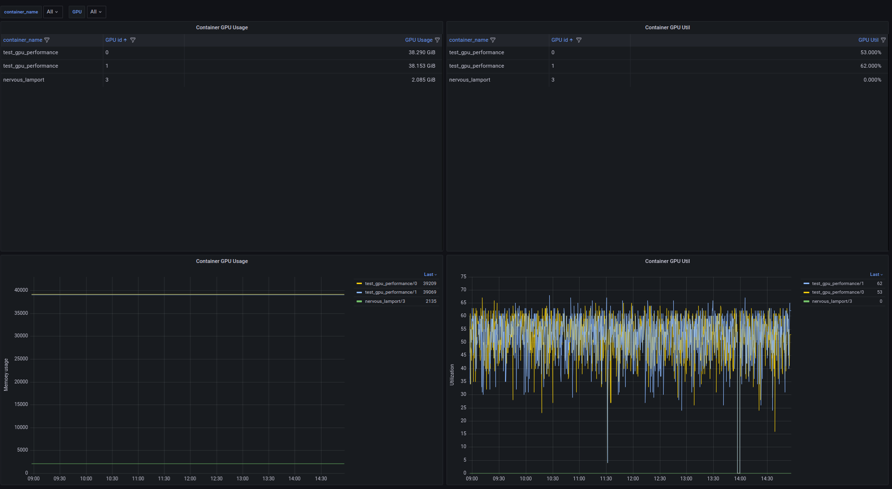

# Docker Container GPU Exporter

## Quick start
Currently the exporter only works as a service (next will be containarized).

1. Run `python3 docker_gpu_exporter_v3.py`
2. Check `http://hostname:9066` to make sure it exposes the metrics.
3. Register `hostname:9066` in your Prometheus configuration file:

   ```yaml
   - job_name: 'docker_container_gpu_metrics'
     static_configs:
       - targets: ["hostname:9066"]
   ```

### Using `d2n.bash` as a Shell Alias

You can easily access container GPU metrics by adding the d2n.bash script as an alias in your shell—no Grafana or additional setup required.
1. **Copy or link** `d2n.bash` into a directory in your `PATH`, for example `~/bin`:

   ```bash
   mkdir -p ~/bin
   cp path/to/d2n.bash ~/bin/
   chmod +x ~/bin/d2n.bash
   ```

2. **Add an alias** to your shell profile (`~/.bashrc`, `~/.zshrc`, etc.) (d2n = Docker container to Nvidia GPU):

   ```bash
   alias d2n="d2n.bash"
   ```

3. **Reload** your profile or restart your terminal:

   ```bash
   source ~/.bashrc   # or ~/.zshrc
   ```

4. **Use it** anywhere by running:

   ```bash
   d2n
   ```

## Exported metrics
This exporter will expose these metrics corresponding to each container name and GPU:

* `container_running_gpu_pid`
* `container_name`
* `container_used_gpu_id`
* `container_utilization_gpu_percent`
* `container_gpu_memory_used_MiB`
* `container_total_gpu_used`

Download Grafana dashboard [Here](Docker_container_gpu_JSON_model.json)
## How it works
Using a bash script to:

* Run `nvidia-smi` and grep all processes that use the GPU.
* Loop through processes and run:

  * `nvidia-smi pmon -c 1` to get the current process utilization of the memory and which GPU ID it's using.
  * `nvidia-smi --query-compute-apps=pid,process_name,used_memory --format=csv` and grep GPU usage of the process.
  * Map the PID to a container name.
* Then use `prometheus-client` to parse and construct the metrics.

## TODO

1. ~~Export metrics container GPU metrics~~
2. Dockerizing (Require `-v /var/run/docker.sock:/var/run/docker.sock` and visibility to host GPU processes).
3. Enhance Grafana dashboard.
